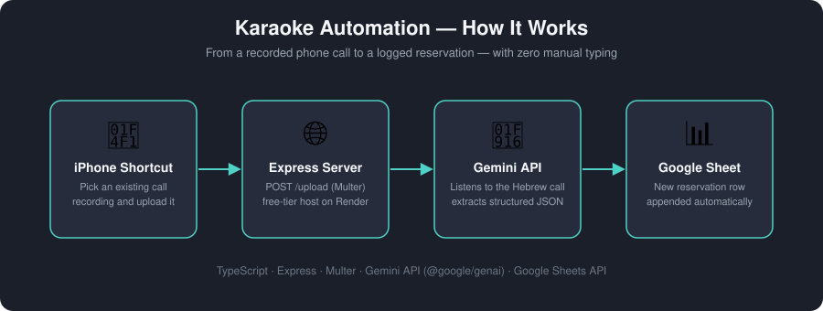

# Karaoke Automation



Automates logging phone-call karaoke reservations into a Google Sheet. Instead of manually transcribing a phone call and typing the details into a spreadsheet, this project listens to the recorded call with Google's Gemini API, extracts the structured reservation details in Hebrew, and appends them as a new row — with zero manual data entry.

## How it works

1. A recorded phone call (Hebrew audio) is sent to the app — either as a local file via the CLI, or uploaded over HTTP.
2. The audio is sent to the **Gemini API**, which listens to the call and extracts the reservation details (customer name, phone, date, time, number of participants, pricing, deposit terms, etc.) as structured JSON, following the business's own pricing rules.
3. The structured data is appended as a new row to a **Google Sheet** via the Google Sheets API.

## Features

- **CLI mode** — process a local audio file directly from the terminal.
- **Web server mode** — an Express server with a `POST /upload` endpoint, so the same pipeline can be triggered remotely (e.g. from a phone, with no computer involved).
- **Deployed on Render** as a free Web Service, listening on `process.env.PORT`.
- **Phone-triggered in practice** — an iOS Shortcut on the business owner's phone picks an existing voice recording and uploads it straight to the deployed endpoint, turning a recorded phone call into a logged spreadsheet row in seconds.

## Tech stack

- **TypeScript** / Node.js
- **Express** + **Multer** for the HTTP upload endpoint
- **Gemini API** (`@google/genai`, Google AI Studio) for audio understanding and structured extraction
- **Google Sheets API** (`googleapis`) for writing results

## Project structure

```
src/
  index.ts            CLI entry point
  server.ts           Express server (deployed entry point)
  types.ts            Reservation data shape + spreadsheet column order
  services/
    gemini.ts         Audio -> Gemini -> structured JSON
    sheets.ts         Appends a row to the Google Sheet
```

## Running locally

Install dependencies:
```bash
npm install
```

**CLI:**
```bash
npx ts-node src/index.ts path/to/call.ogg
```

**Web server:**
```bash
npm run server
```
Then, from another terminal, upload an audio file the same way a client would:
```bash
curl -X POST http://localhost:3000/upload -F "audio=@test.ogg"
```

## Environment variables

Create a `.env` file in the project root:
```
GEMINI_API_KEY=your_gemini_api_key
SPREADSHEET_ID=your_google_sheet_id
```

Google Sheets authentication also requires a service-account key, shared with the target spreadsheet:
- **Local development** — place the key as `credentials.json` in the project root.
- **Production (e.g. Render)** — set the `GOOGLE_CREDENTIALS_JSON` environment variable to the full contents of that same key file, since a plain file isn't available on most hosting platforms.

## Deployment

Deployed as a Render **Web Service**:
- Build command: `npm install && npm run build`
- Start command: `npm run start:server`
- `PORT` is provided automatically by Render — the server reads it via `process.env.PORT`.

## Sample audio

`test.ogg` is a short, self-recorded sample call used for manually testing the pipeline end-to-end. It is not a real customer recording.
